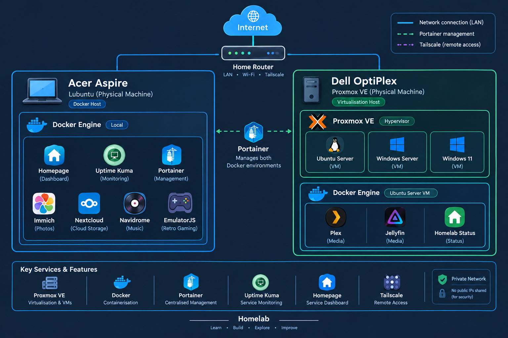
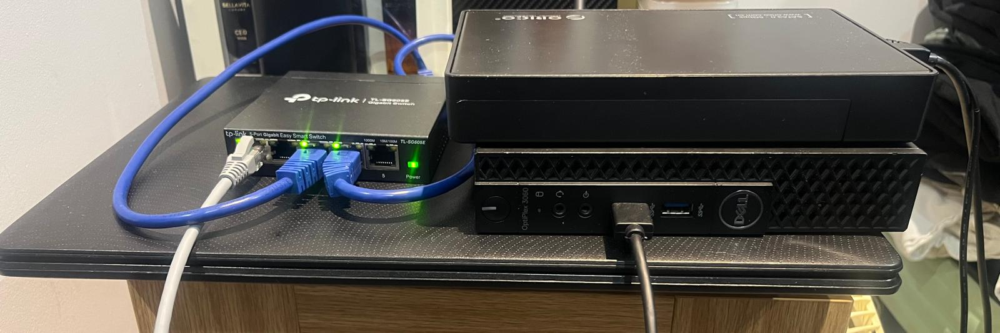
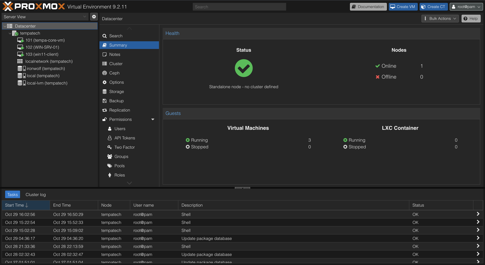
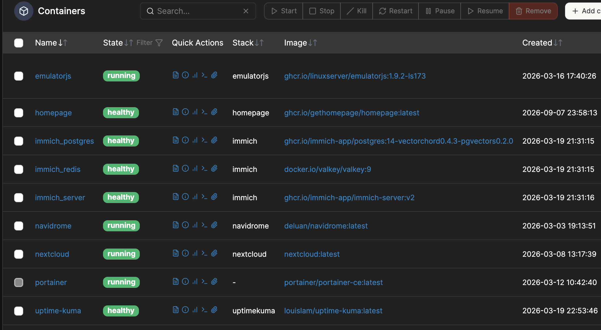
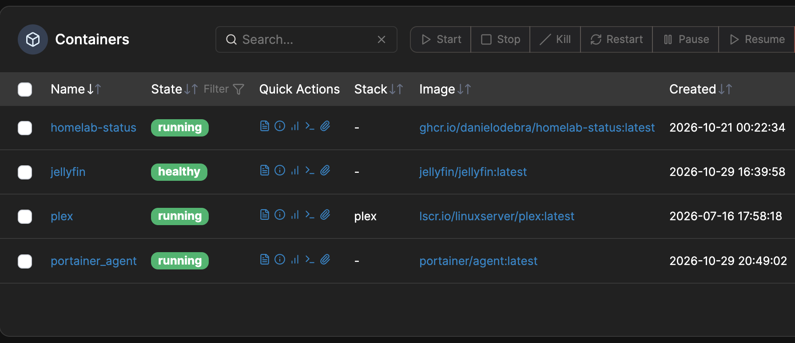
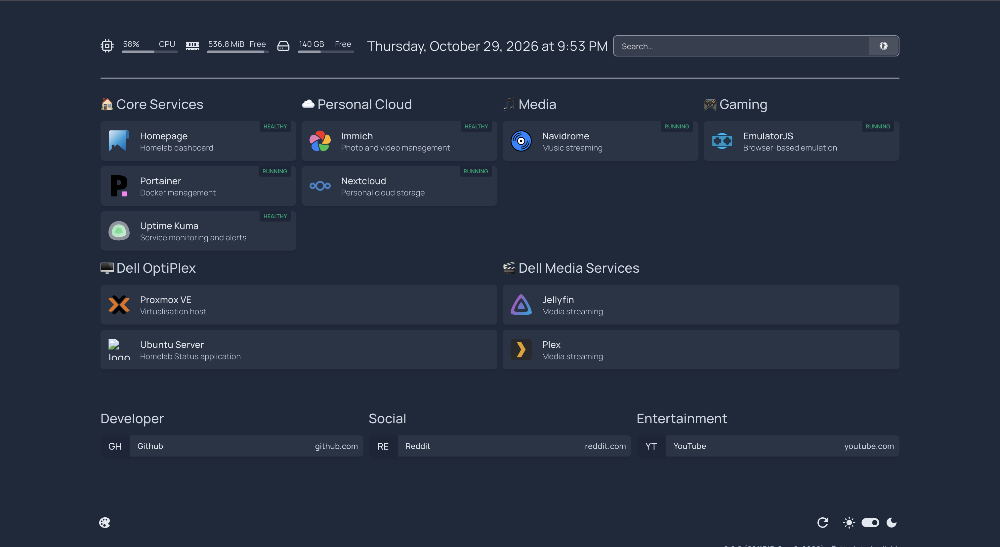

# Homelab — Infrastructure, Virtualisation & Self-Hosting

A personal homelab project focused on building practical experience in Linux administration, virtualisation, containerisation, networking, infrastructure management and DevOps.

What started as a repurposed laptop running Linux and a collection of self-hosted applications has evolved into a two-machine infrastructure environment, combining Proxmox VE, Ubuntu Server, Docker, centralised management and automated deployments.

The goal is to develop practical engineering skills by building, managing, troubleshooting and continuously improving real infrastructure.

---

## 1. Infrastructure Architecture

The homelab consists of two physical machines operating across a local network.

- **Acer Aspire:** Lubuntu-based Linux server running Docker and self-hosted services.
- **Dell OptiPlex:** Proxmox VE host running multiple virtual machines, including an Ubuntu Server VM hosting Docker workloads.

Portainer provides centralised management of both Docker environments, while Homepage and Uptime Kuma provide service access and availability monitoring.

---

## 2. Physical Infrastructure

The environment runs across two repurposed physical machines.

| Machine | Operating System / Platform | Purpose |
|---|---|---|
| Acer Aspire | Lubuntu | Linux server and Docker host |
| Dell OptiPlex | Proxmox VE | Virtualisation host |

The two machines provide separate environments for self-hosted applications, virtualisation, media services and infrastructure management.

---

## 3. Virtualisation — Proxmox VE

The Dell OptiPlex runs Proxmox Virtual Environment (VE), providing a platform for managing virtual machines.

Current virtual machines:

| Virtual Machine | Operating System | Purpose |
|---|---|---|
| Ubuntu Server (`tempa-core`) | Ubuntu Server | Docker workloads and application hosting |
| Windows Server | Windows Server | Windows server administration and lab environment |
| Windows 11 | Windows 11 | Windows client testing and administration |

This environment provides practical experience with virtualisation, VM management, Linux and Windows administration.

---

## 4. Docker Services

Docker is used to deploy and manage containerised applications across both physical machines.

### Acer Aspire — Docker Host

| Service | Purpose |
|---|---|
| Homepage | Centralised service dashboard |
| Portainer | Docker management |
| Uptime Kuma | Service availability monitoring |
| Immich | Self-hosted photo and video management |
| Nextcloud | Personal cloud storage and collaboration |
| Navidrome | Self-hosted music streaming |
| EmulatorJS | Browser-based retro gaming |

### Dell Ubuntu Server — Docker Host

| Service | Purpose |
|---|---|
| Plex | Media streaming |
| Jellyfin | Self-hosted media streaming |
| Homelab Status | Custom homelab status application |
| Portainer Agent | Remote Docker environment management |

Applications are deployed using Docker, with container configuration and management handled across the two Docker hosts.

---

## 5. Centralised Container Management — Portainer

Portainer provides centralised management of both Docker environments from a single dashboard running on the Acer Aspire.

Connected environments:

| Environment | Host | Connection |
|---|---|---|
| `local` | Acer Aspire | Local Docker socket |
| `Dell-tempa-core` | Dell Ubuntu Server | Portainer Agent |

### Acer Aspire

### Dell Ubuntu Server

The Portainer Agent allows the central Portainer installation to communicate with the Docker Engine running on the Dell Ubuntu Server.

This provides a single management interface for monitoring and managing containers across both machines.

---

## 6. Monitoring and Service Management

Two applications provide visibility and management of the homelab.

### Homepage

Homepage provides a central dashboard for accessing applications and infrastructure services hosted across both machines.

### Uptime Kuma

Uptime Kuma monitors the availability of services across the homelab.

It provides visibility into service health, response times and availability.

Monitoring is being expanded to cover services hosted on both the Acer Aspire and Dell Ubuntu Server.

---

## 7. Networking and Remote Access

The homelab operates across a local network, with Tailscale providing secure remote connectivity between devices.

Technologies and concepts used:

- Local network addressing and connectivity.
- SSH for remote Linux administration.
- Tailscale for remote access.
- NFS for network file sharing between the Proxmox host and Ubuntu Server VM.
- Docker networking and service ports.

Remote connectivity is used to administer infrastructure without requiring direct physical access to the machines.

Private IP addresses, device identifiers and sensitive network configuration are intentionally excluded from this public documentation.

---

## 8. Storage and Media Infrastructure

A Seagate IronWolf 4TB hard drive provides additional storage for media and homelab data.

The drive is connected to the Dell OptiPlex through an ORICO USB 3.0 enclosure and formatted with the EXT4 filesystem.

It is mounted on the Proxmox host and shared with the Ubuntu Server VM through Network File System (NFS).

### Storage Configuration

| Component | Details |
|---|---|
| Storage drive | Seagate IronWolf 4TB |
| Enclosure | ORICO 3588US3 USB 3.0 |
| Filesystem | EXT4 |
| Proxmox mount point | `/mnt/storage` |
| Sharing protocol | NFS |
| Connected virtual machine | Ubuntu Server (`tempa-core`) |

### Media Services

| Service | Purpose |
|---|---|
| Plex | Media streaming |
| Jellyfin | Self-hosted media streaming |

### Engineering Experience

This setup has provided practical experience with:

- Linux disk management.
- EXT4 filesystem administration.
- Filesystem mounting and persistence.
- Persistent mount configuration.
- NFS exports and client mounts.
- Docker volume and bind-mount configuration.
- Storage troubleshooting and recovery.

Storage reliability and automated backups remain areas for improvement.

---

## 9. Engineering Experience and Projects

This homelab is an ongoing practical engineering project.

Some of the areas I've worked on include:

| Area | Practical Experience |
|---|---|
| Linux administration | Managing Lubuntu and Ubuntu Server |
| Virtualisation | Installing and managing Proxmox VE and virtual machines |
| Containerisation | Deploying and managing Docker containers |
| Container management | Connecting and managing two Docker environments through Portainer |
| CI/CD | Building GitHub Actions workflows |
| Container registry | Building and publishing Docker images to GitHub Container Registry |
| Automated deployment | Deploying applications to Ubuntu Server |
| Deployment reliability | Implementing automatic rollback in a CI/CD workflow |
| Networking | SSH, NFS, local networking and Tailscale |
| Monitoring | Service availability monitoring with Uptime Kuma |
| Storage | Managing external storage, EXT4 and NFS |
| Troubleshooting | Investigating Docker, storage, connectivity and service availability issues |

### CI/CD Project

A separate project demonstrates an automated deployment pipeline using GitHub Actions.

The workflow includes:

- Automated testing.
- Docker image building.
- Publishing images to GitHub Container Registry.
- Deployment to the Dell Ubuntu Server.
- Deployment health checks and automatic rollback.

Repository: [devops-cicd-project](https://github.com/danielodebra/devops-cicd-project)

---

## 10. Future Improvements and Engineering Roadmap

The homelab is actively being developed as a learning environment for broader DevOps and Cloud Engineering skills.

Planned improvements include:

| Status | Project | Objective |
|---|---|---|
| Planned | Ansible | Automate Linux server configuration and application deployment |
| Planned | Prometheus | Collect infrastructure and system metrics |
| Planned | Grafana | Build infrastructure monitoring dashboards |
| Planned | Automated backups | Implement scheduled backups and tested restoration |
| Planned | CI/CD improvements | Introduce additional testing and security scanning |
| Planned | Terraform | Provision and manage cloud infrastructure using Infrastructure as Code |
| Planned | Kubernetes | Explore container orchestration when there is a practical use case |

These projects will be introduced incrementally, documented and added to the repository as they are implemented.

---

## 11. Project Philosophy

The purpose of this homelab is not simply to run self-hosted applications.

It is an opportunity to understand how infrastructure is designed, configured, deployed, monitored, secured and maintained.

Every new service, automation workflow and troubleshooting exercise provides an opportunity to develop practical engineering experience.

**Build. Automate. Monitor. Troubleshoot. Improve.**